  

  

<!-- ACTIVITY:START -->

⚪ <b>Last active Oct 5, 2026</b> · latest commit <code>GUI Integrated</code> in <a href="https://github.com/aryanbhosaleofficial-debug/Obrita-SIH26174">Obrita-SIH26174</a>

<!-- ACTIVITY:END -->

  
  <!--  -->

## About Me

I'm an AI/ML developer with a strong backend engineering foundation. I build machine learning models in Python and the systems around them: the data pipelines that feed them and the APIs that serve them in production.

- Building and evaluating machine learning models
- Deploying models as scalable APIs with FastAPI and Docker
- Designing data pipelines for training and inference
- Open to AI/ML and backend engineering roles and collaborations

## How I Work

  

## Tech Stack

| | |
| --- | --- |
| **AI / ML** |    |
| **Languages** |  &nbsp; SQL |
| **Backend** |  |
| **Databases** |  |
| **DevOps & Tools** |  |

## Current Focus

| Area | What I'm working on |
| --- | --- |
| **Machine Learning** | Model building, evaluation and feature engineering |
| **Model Deployment** | Serving models behind APIs with FastAPI and Docker |
| **Data Pipelines** | Ingestion, preprocessing and reliable ETL for ML workflows |
| **Backend Architecture** | Clean, scalable services that power AI products |

<!-- Add 2–3 of your best projects here, then remove these comment markers:
## Featured Projects

| Project | What it does | Stack |
| --- | --- | --- |
| [Project Name](https://github.com/aryanbhosaleofficial-debug/repo) | One line on the problem it solves and the result | FastAPI · PostgreSQL · Docker |
| [Project Name](https://github.com/aryanbhosaleofficial-debug/repo) | One line on the problem it solves and the result | Python · scikit-learn |
-->

## GitHub

  

  <picture>
    <source media="(prefers-color-scheme: dark)" srcset="https://raw.githubusercontent.com/aryanbhosaleofficial-debug/aryanbhosaleofficial-debug/output/github-contribution-grid-snake-dark.svg" />
    <source media="(prefers-color-scheme: light)" srcset="https://raw.githubusercontent.com/aryanbhosaleofficial-debug/aryanbhosaleofficial-debug/output/github-contribution-grid-snake.svg" />
    
  </picture>

