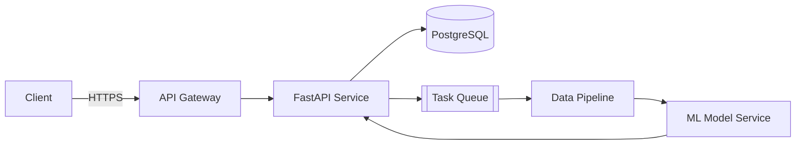

<p align="center">
  
</p>

<p align="center">
  
</p>

<p align="center">
  <!-- Add your links here, e.g.
  <a href="https://www.linkedin.com/in/YOUR_LINKEDIN/"></a>
  <a href="mailto:YOUR_EMAIL"></a>
  -->
  
</p>

---

### `> whoami`

```python
from dataclasses import dataclass, field

@dataclass
class Aryan:
    role: str = "Backend Engineer"
    focus: list = field(default_factory=lambda: [
        "API design & backend architecture",
        "Data pipelines",
        "ML fundamentals & model deployment",
    ])
    currently: str = "Turning ML models into production-ready services"
    philosophy: str = "Reliable > clever. Measure, then optimize."

    def status(self) -> str:
        return "Open to collaborating on backend & AI/ML projects"
```

---

### ⚙️ Tech Stack

<p align="center">
  <b>Languages</b><br/>
  
  
</p>

<p align="center">
  <b>Backend Frameworks</b><br/>
  
</p>

<p align="center">
  <b>Databases</b><br/>
  
</p>

<p align="center">
  <b>DevOps & Tools</b><br/>
  
</p>

<p align="center">
  <b>AI / ML</b><br/>
  
  
  
</p>

---

### 🏗️ How I Think About Systems



---

### 🧠 Current Focus

| Area | What I'm working on |
| --- | --- |
| 🏛️ **Backend Architecture** | Clean, scalable service design and API contracts |
| 🔄 **Data Pipelines** | Ingestion, transformation and reliable ETL workflows |
| 📊 **ML Fundamentals** | Core algorithms, evaluation and feature engineering |
| 🚀 **Model Deployment** | Serving models behind APIs with Docker |
| 🤖 **AI/ML Engineering** | Bridging research models and real products |

<!--
### 🚀 Featured Projects

| Project | Description | Stack |
| --- | --- | --- |
| [Project Name](https://github.com/aryanbhosaleofficial-debug/repo) | One-line description of what it does | FastAPI · PostgreSQL · Docker |
| [Project Name](https://github.com/aryanbhosaleofficial-debug/repo) | One-line description of what it does | Python · scikit-learn |
-->

---

### 📈 GitHub Analytics

<p align="center">
  
  
</p>

<p align="center">
  
</p>

<p align="center">
  
</p>

---

### 🐍 Contribution Snake

<p align="center">
  <picture>
    <source media="(prefers-color-scheme: dark)" srcset="https://raw.githubusercontent.com/aryanbhosaleofficial-debug/aryanbhosaleofficial-debug/output/github-contribution-grid-snake-dark.svg" />
    <source media="(prefers-color-scheme: light)" srcset="https://raw.githubusercontent.com/aryanbhosaleofficial-debug/aryanbhosaleofficial-debug/output/github-contribution-grid-snake.svg" />
    
  </picture>
</p>

<p align="center">
  
</p>
